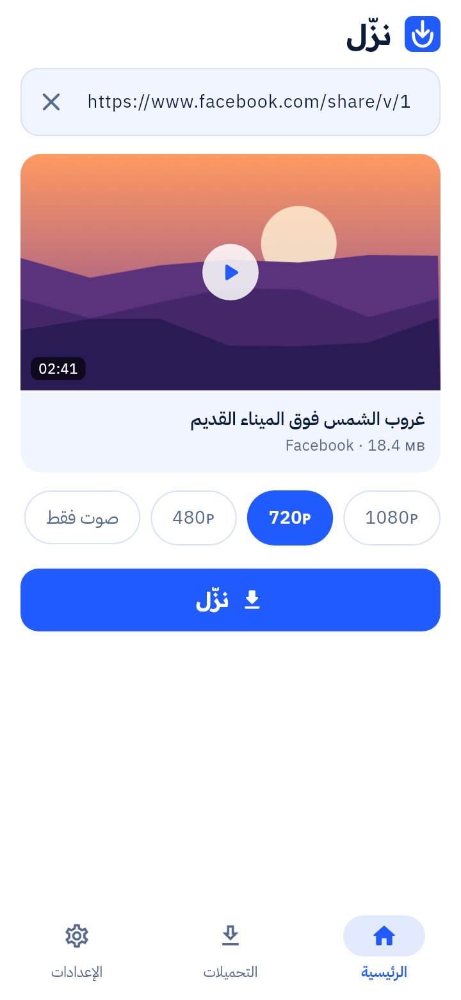
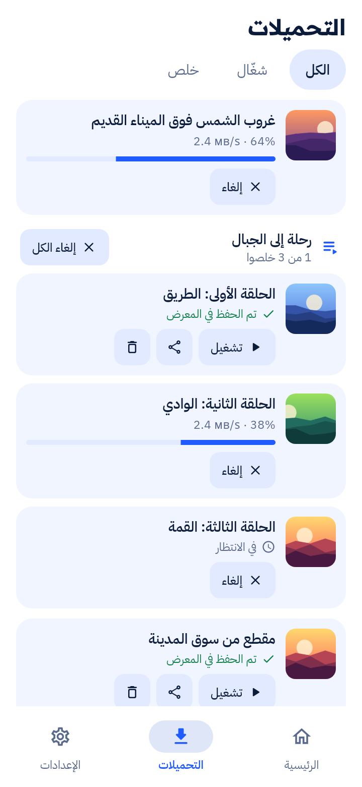
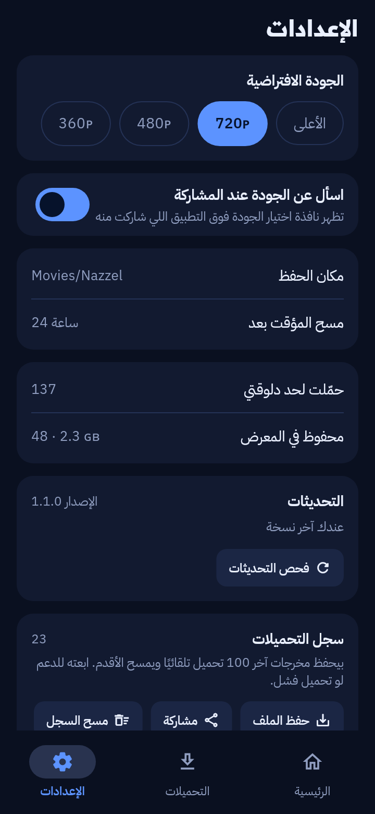

# Nazzel

**English** · [العربية](README.ar.md)

An Android app that saves videos and audio from Facebook, YouTube, TikTok, Instagram and many other sites to your phone.

Share a post from any app and pick a quality in a sheet that opens on top of it, or paste a link. The download runs on the phone itself and nothing passes through a server or needs an account. Sites block a phone's own connection far less often than the shared servers that most download services use.

<p>
  
  
  
  
</p>

The interface is in Arabic.

## What it does

- Opens from the share menu with a quality sheet, so you stay in the app you were using. A quick mode skips the sheet and saves the best quality
- Fills in a link you copied as soon as you open the app
- Downloads playlists, albums and posts with several videos; you pick the items and follow each one
- Saves Spotify tracks, albums and playlists as audio by finding them on YouTube
- Keeps downloading in the background with a progress notification, and saves to the gallery under `Movies/Nazzel` and `Music/Nazzel`
- Updates its downloader on its own and offers new app versions from inside the app
- Keeps a log of the last 100 downloads that you can save or share when something fails

[Read how it works](docs/how-it-works.md)

## Supported sites

Facebook, YouTube, TikTok, Instagram (public posts), X, Dailymotion, SoundCloud, Reddit, Pinterest, Snapchat Spotlight, Twitch, Vimeo, Bluesky, LinkedIn, Tumblr, VK, Bilibili, Likee, Rumble, Kick and Spotify. Other sites supported by yt-dlp usually work as well.

Private posts and posts that need an account are not supported.

## Install

Download `nazzel.apk` from the [latest release](https://github.com/Zaky1m/nazzel/releases/latest) and open it on the phone. Android 10 or later on a 64-bit ARM phone is required. Later versions are offered inside the app.

## Build

See [docs/building.md](docs/building.md). In short:

```bash
tools/fetch-qjs.sh
flutter build apk --release --target-platform android-arm64
```

## Contributing

Bug reports with the download log attached are the most useful; the issue form explains how to get it. For code changes read [CONTRIBUTING.md](CONTRIBUTING.md) and [docs/SPEC.md](docs/SPEC.md).

## License

[MIT](LICENSE). Bundled components keep their own licenses, listed in [THIRD_PARTY_NOTICES.md](THIRD_PARTY_NOTICES.md).

## References

- [yt-dlp](https://github.com/yt-dlp/yt-dlp), which does the downloading
- [QuickJS-NG](https://github.com/quickjs-ng/quickjs) and [curl_cffi](https://github.com/lexiforest/curl_cffi), which help with YouTube and sites that check browsers
- [Chaquopy](https://github.com/chaquo/chaquopy), which runs Python on Android
